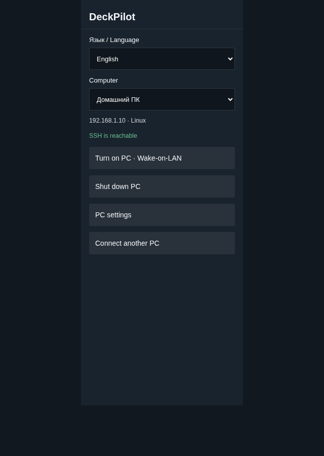
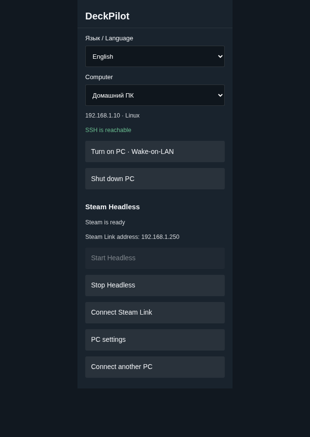

# DeckPilot 0.3.0

[Русский](README.md) | **English**

Turn your home PC on and off from a Steam Deck. If you use Steam Headless on a Linux PC, add controls for its gaming session.

Download 0.3.0: [Decky plugin](https://github.com/flathead/DeckPilot/releases/download/v0.3.0/deckpilot-0.3.0.zip), [PC helpers](https://github.com/flathead/DeckPilot/releases/download/v0.3.0/deckpilot-host-0.3.0.zip), [source code](https://github.com/flathead/DeckPilot/releases/download/v0.3.0/deckpilot-source-0.3.0.zip).

DeckPilot is a fork of [PC On/Off by proilyxa](https://github.com/proilyxa/deck-pc-on-off), under the BSD-3-Clause license.

## Screenshots

| PC power | Steam Headless |
| --- | --- |
|  |  |

Preview screenshots use stand-ins for Decky components.

## Install

1. On your Deck, install `deckpilot-0.3.0.zip` through Decky Loader's developer settings. Open DeckPilot.
2. On the PC you want to control, extract `deckpilot-host-0.3.0.zip`.
3. Start the PC setup wizard and complete the four steps in DeckPilot.

### Linux PC

Open `Setup-Linux.desktop` and allow it to run if your file manager asks. You can also open a terminal in the bundle directory and run:

```bash
bash setup-linux.sh
```

Setup requests sudo access, installs packages and asks whether you use Steam Headless. If UFW or firewalld is active, it offers to allow Deck access from your wired and Wi-Fi LAN subnets. It then displays an eight-digit PIN.

The package installer supports Arch/CachyOS, Debian/Ubuntu and Fedora with systemd through pacman, apt-get and dnf. Other distributions need an adapter. Hardware testing on those distributions is still required.

### Windows PC

Open `Setup-Windows.cmd` and approve the administrator prompt. You need 64-bit Windows 10/11 with the OpenSSH Server optional feature and Windows PowerShell 5.1. Windows may download OpenSSH through Windows Update. If it requests a restart, restart the PC and run setup again.

Select the Ethernet adapter for Wake-on-LAN. Use a home network with the Windows **Private** profile: DeckPilot firewall rules allow LocalSubnet in that profile. The wizard displays the pairing PIN.

The Windows helper supports PC power controls. Steam Headless and Ambxst integration require a Linux host in this release; Docker Desktop and WSL are not supported.

### Steam Deck

Choose the PC operating system. Setup explains Steam Headless and asks whether it is installed. Choose **No** to use PC power controls without Headless.

Find the PC, then select it if discovery returns several results. If discovery fails, enter the PC's local IP address.

Enter the PIN shown on the PC and select **Connect**. The PC will show a verification code, for example `5AC1-80D4-F9C2`. Compare it with the code on the Deck. If they match, type `YES` on the PC within one minute. DeckPilot checks SSH login and saves the PC. Setup handles the keys; you do not need to copy them.

If the codes differ, reject the request. Pair on a home network you trust.

## Language

**Russian is the default**, regardless of your Steam or system language. Use the **Язык / Language** list to choose **Русский** or **English**. The selector appears on each screen, including first setup. DeckPilot saves your choice in `preferences.json` beside the PC settings.

An existing installation without a language preference starts in Russian. If the preference file is corrupt or contains an unsupported language, DeckPilot falls back to Russian.

The choice covers labels, confirmations, status messages, notifications and plugin errors. PC names, addresses and pairing codes stay unchanged. PC setup wizards use Russian; system utilities follow the OS language.

## Use

**Turn on PC** sends Wake-on-LAN packets. Wait for the PC to become reachable. **Shut down PC** asks for confirmation, then sends a shutdown command over SSH. Save games and documents first.

The connection status checks the SSH port. The connection check in PC settings verifies login with the saved keys. An open port alone does not prove that the helper works.

Wake-on-LAN requires support from your network adapter and BIOS/UEFI. Wired Ethernet is the more reliable option. Linux setup enables magic packets and saves the setting through NetworkManager and `deckpilot-wol.service`. Windows setup attempts to enable Wake on Magic Packet on the selected adapter. If waking from shutdown fails, check Ethernet power, ErP/Deep Sleep and Windows Fast Startup. Setup does not change BIOS settings or Fast Startup.

## Steam Headless

With Steam Headless, you stream games to the Deck through Steam Remote Play / Steam Link while keeping the PC desktop free. This requires a separate Steam session in a container on a Linux PC. DeckPilot controls an existing session; it does not install Steam Headless.

If you decline Headless, its controls and status stay hidden on the home screen. To add it later, set up Steam Headless, run the Linux PC wizard again and select its integration. Then open **PC settings → Add Steam Headless… → Check and add** on the Deck. You do not need to pair the Deck again.

| Integration | Controls |
| --- | --- |
| Ambxst mod `local.steam-headless-control` | Session status, start, graceful game and Steam shutdown, Steam Link PIN |
| Existing container in regular Docker | Container status, start and SIGTERM without a forced SIGKILL; check Steam readiness on the Deck |

For Ambxst, setup looks for the installed mod package backend, then `~/.local/bin/steam-headless`, and runs `config-check`. The controller must support JSON `status/start/stop` commands; PIN submission needs `pair` and `pair-status`.

DeckPilot runs the controller as the installation owner and uses its library checks, locks and shutdown sequence. It does not change mod files or the installation profile.

For regular Docker, select an existing container by its exact name. Setup uses `/var/run/docker.sock`. It does not install Docker, create a container, select a GPU or sign in to Steam. Stop uses `--time=-1`: Docker waits for the container to exit without SIGKILL. If the wait takes too long, check its status on the PC.

Waking the PC and starting Headless use separate buttons. Stopping Headless leaves the PC on. Concurrent gaming sessions depend on Steam accounts and game access; you may need separate accounts.

To submit a Steam Link PIN, open Steam Link on the Deck, select the Headless PC and enter the four digits shown on the Deck into DeckPilot. The Ambxst controller passes them to Steam inside Headless. This PIN differs from DeckPilot's eight-digit setup PIN.

## Upgrade from PC On/Off

DeckPilot installs under a new name. While its PC list is empty, choose **Import PCs from PC On/Off**. The importer reads the adjacent `PC On Off/hosts.json` settings directory. If your settings use another location, connect the PC through setup.

DeckPilot reuses `~/.ssh/decky-power_ed25519` and preserves existing authorized PC keys. The old helper supports PC power controls. To add Headless, rerun PC setup and enable the integration in DeckPilot settings. After migration, you can remove the old plugin from Decky.

Upgrading DeckPilot from 0.2.0 preserves PC settings and keys. The language starts in Russian until you choose another option.

## Access and system changes

Linux setup creates the `deckpower` account with `/var/lib/decky-power` as its home, an SSH command dispatcher, and sshd and sudoers rules. The account accepts checks, shutdown and the configured Headless commands. It cannot open a shell or PTY or forward connections. On SELinux systems, setup configures home and SSH file contexts.

Windows setup creates a **non-administrator** `deckpower` account with a random password. It disables password-based SSH login, desktop login and RDP, grants local shutdown rights and uses `ForceCommand` for check, capabilities and shutdown. The account can read helper files and keys in `%ProgramData%\DeckPilot`; Administrators and SYSTEM can change them. Setup backs up `sshd_config` before editing it.

The temporary pairing server listens on TCP 47833 for up to five minutes. It accepts up to eight PIN attempts and requires approval on the PC. After pairing it exits. Windows removes its temporary firewall rule; UFW removes rules added for pairing; firewalld rules expire on a timer. SSH access rules remain for PC control.

Initial pairing sends the PIN and public key over LAN HTTP. The verification code depends on both SSH keys. Compare the codes on both devices before approving the request on the PC. The private key stays on the Deck. Later commands use SSH and check the saved host key. DeckPilot accepts private RFC1918 IPv4 addresses; discovery scans the local `/24`.

To revoke a Deck, remove its key from `/var/lib/decky-power/.ssh/authorized_keys` on Linux or `%ProgramData%\DeckPilot\authorized_keys` on Windows. Removing DeckPilot from the Deck does not uninstall the PC helper.

## Troubleshooting

| Problem | Action |
| --- | --- |
| Discovery cannot find the PC | Keep its wizard open, check LAN and Wi-Fi isolation, or enter its IP |
| PIN expired or request rejected | Run PC setup again |
| SSH fails after setup | Use the connection check in PC settings; check ssh/sshd and LAN firewall rules |
| Another SSH key is saved for the IP | Verify which PC uses the address, remove its stale known_hosts entry on the Deck, then pair again |
| Headless controls are missing | Rerun Linux setup with an integration, then add it in DeckPilot settings |
| Ambxst refuses to stop | Save or close the game in Headless and check the PC controller |
| Windows Update cannot install OpenSSH | Install OpenSSH Server through Windows optional features, then rerun setup |
| Language choice cannot be saved | Check write access to the DeckPilot settings directory |

## Checks and limits

The backend suite covers 21 tests: address and command validation, settings and key permissions, migration, changed SSH keys, PIN rejection, approved local HTTP pairing, and language persistence and fallback.

Frontend tests cover first setup, Headless opt-out and later opt-in, failed connections, the Windows flow, language switching and reload. The build checks that both catalogs contain the same messages and substitution parameters.

PowerShell parses the Windows setup script, and the LSA helper compiles. Pairing HTTP was tested under PowerShell on Linux using temporary files and mocked system commands. This does not test installation, ACLs or shutdown on real Windows.

Layout was checked with React and stand-ins for Decky components at 320 px panel width. Native gamepad focus still needs testing on a Steam Deck.

This release has not run on a physical Steam Deck or Windows PC. Wake-on-LAN, SSH and game shutdown need checks on the target devices.

## Translations

Plugin messages live in `locales/ru.json` and `locales/en.json`. Keys use Russian source messages; values contain UI text. Keep placeholders such as `{name}` in both languages, then run `python3 tools/build.py`.

The build embeds translations in `dist/index.js`, so switching language needs no internet connection. Unknown errors from external controllers use a failure message in the selected language. DeckPilot's own errors include translated causes and SSH exit codes.

## Source and checks

```bash
python3 tools/build.py
python3 -m unittest discover -s tests -v
node tests/frontend.mjs
bash -n tools/setup-linux.sh
node --check dist/index.js
```

To test the Windows pairing protocol, install PowerShell 7 on the development machine:

```bash
DECKPILOT_PWSH=/path/to/pwsh python3 tests/windows-protocol.py
```

`build.py` embeds frontend translations and creates the standalone Linux installer from its template and Python helpers. No npm dependencies are required. Network tests need access to loopback sockets.

Build the installation and source archives with:

```bash
python3 tools/package.py --output ../releases
```

The source archive excludes Git metadata and Python caches. Add `--copy-to /path/to/downloads` to copy the bundle to another directory.

Windows OpenSSH documentation: [installation](https://learn.microsoft.com/en-us/windows-server/administration/openssh/openssh_install_firstuse) and [server configuration](https://learn.microsoft.com/en-us/windows-server/administration/openssh/openssh-server-configuration).
