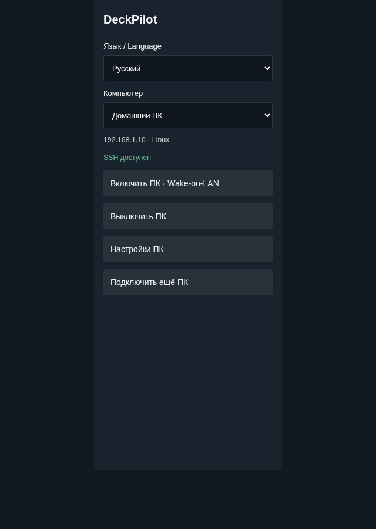
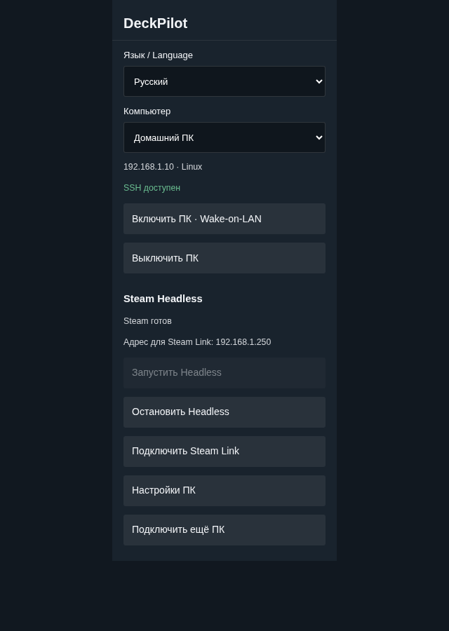

# DeckPilot 0.3.0

**Русский** | [English](README.en.md)

Включайте и выключайте домашний ПК с Steam Deck. Если на Linux-ПК установлен Steam Headless, добавьте кнопки запуска и остановки его игровой сессии.

Скачать 0.3.0: [плагин для Decky](https://github.com/flathead/DeckPilot/releases/download/v0.3.0/deckpilot-0.3.0.zip), [помощники для ПК](https://github.com/flathead/DeckPilot/releases/download/v0.3.0/deckpilot-host-0.3.0.zip), [исходники](https://github.com/flathead/DeckPilot/releases/download/v0.3.0/deckpilot-source-0.3.0.zip).

Форк [PC On/Off от proilyxa](https://github.com/proilyxa/deck-pc-on-off), лицензия BSD-3-Clause.

## Скриншоты

| Питание ПК | Steam Headless |
| --- | --- |
|  |  |

Снимки тестового интерфейса с компонентами-заменителями Decky.

## Установка

1. На Deck установите `deckpilot-0.3.0.zip` через установку ZIP в настройках разработчика Decky Loader. Откройте DeckPilot.
2. На ПК распакуйте `deckpilot-host-0.3.0.zip`.
3. Запустите мастер на ПК и пройдите четыре шага в DeckPilot.

### Linux-ПК

Откройте `Setup-Linux.desktop`. Если файловый менеджер попросит разрешить запуск, разрешите. Откроется терминал с мастером. Запасной способ из папки комплекта:

```bash
bash setup-linux.sh
```

Мастер запросит sudo, установит пакеты и предложит подключить Steam Headless. При наличии UFW или firewalld он предложит разрешить связь с Deck для подсетей проводных и Wi-Fi-интерфейсов. Затем он покажет PIN из восьми цифр.

Автоустановка пакетов поддерживает Arch/CachyOS, Debian/Ubuntu и Fedora с systemd через pacman, apt-get и dnf. Другим дистрибутивам нужен отдельный адаптер. Скрипт на этих дистрибутивах не проходил аппаратную проверку.

### Windows-ПК

Запустите `Setup-Windows.cmd` и подтвердите запрос администратора. Нужны 64-битная Windows 10/11 с доступным компонентом OpenSSH Server и Windows PowerShell 5.1. Windows может скачать компонент через Windows Update. Если она запросит перезагрузку, перезагрузите ПК и повторите запуск.

В мастере выберите Ethernet-адаптер для Wake-on-LAN. Подключите ПК к домашней сети с профилем Windows «Частная»: правила DeckPilot разрешают связь из LocalSubnet в этом профиле. PIN появится в окне мастера.

Помощник Windows управляет питанием ПК. Интеграция Steam Headless и Ambxst в этом выпуске работает на Linux; Docker Desktop и WSL не поддерживаются.

### На Steam Deck

Выберите систему ПК. Мастер объяснит Steam Headless и предложит подключить его, если он установлен. Ответ «Нет» оставит управление питанием.

Нажмите поиск ПК. Если он найдёт несколько компьютеров, выберите нужный. При необходимости введите локальный IP.

Введите PIN с ПК и нажмите «Подключить». На ПК появится **код сверки**, например `5AC1-80D4-F9C2`. Сравните его с кодом на Deck. Если они совпадают, введите `YES` на ПК в течение минуты. DeckPilot проверит SSH и сохранит компьютер. Ключи создаст мастер; копировать их не нужно.

Если коды различаются, отклоните запрос на ПК. Первую настройку проводите в домашней сети, которой доверяете.

## Язык

По умолчанию плагин открывается на русском. В списке **Язык / Language** выберите «Русский» или «English». Переключатель доступен на каждом экране, включая первое подключение. DeckPilot сохраняет выбор в `preferences.json` рядом с настройками ПК.

Язык Steam и системы не меняет начальную настройку. Старым установкам без выбора языка DeckPilot назначает русский. При повреждённом файле настроек или неизвестном языке он возвращается к русскому.

Выбор меняет интерфейс, подтверждения, статусы, уведомления и ошибки плагина. Названия ПК, IP-адреса и коды остаются как есть. Мастера на ПК открываются на русском; вывод системных утилит зависит от языка ОС.

## Управление

«Включить ПК» отправляет Wake-on-LAN. Дождитесь появления связи с ПК. «Выключить ПК» просит подтверждение и отправляет команду завершения работы по SSH. Перед этим сохраните игру и документы.

Статус связи проверяет порт SSH, а кнопка проверки в настройках проверяет вход с сохранёнными ключами. Открытый порт сам по себе не подтверждает работоспособность помощника.

Для WoL нужна поддержка сетевой карты и BIOS/UEFI. Надёжнее использовать Ethernet. Мастер Linux включает magic packet и сохраняет настройку в NetworkManager и службе `deckpilot-wol.service`. В Windows он пытается включить Wake on Magic Packet для выбранного адаптера. При проблемах проверьте питание Ethernet после выключения, ErP/Deep Sleep и быстрый запуск Windows. Мастер не меняет BIOS или быстрый запуск Windows.

## Steam Headless

Со Steam Headless вы играете на Deck через Steam Remote Play / Steam Link, а основной рабочий стол ПК остаётся свободным. Для этого на Linux-ПК нужна отдельная сессия Steam в контейнере. DeckPilot управляет установленной сессией; сам Steam Headless он не устанавливает.

Если вы отказались от Headless, на главном экране не будет его кнопок и статусов. Позже установите и настройте Steam Headless, повторите мастер на Linux-ПК с выбором интеграции, затем откройте **Настройки ПК → Добавить Steam Headless… → Проверить и добавить**. Сопряжение Deck повторять не нужно.

Доступны два способа подключения:

| Интеграция | Возможности |
| --- | --- |
| Мод Ambxst `local.steam-headless-control` | Статус сессии, запуск, штатная остановка игры и Steam, PIN Steam Link |
| Контейнер в обычном Docker | Статус контейнера, запуск и SIGTERM без принудительного SIGKILL; готовность Steam проверяйте на Deck |

Для Ambxst мастер ищет установленный backend пакета мода, затем `~/.local/bin/steam-headless`. Он проверяет `config-check`. Требуется JSON-протокол контроллера с командами `status/start/stop`; для PIN нужны `pair` и `pair-status`. DeckPilot вызывает его от владельца установки и сохраняет его проверки библиотеки, блокировки и порядок остановки. Файлы мода и профиль установки он не меняет.

Для обычного Docker выберите существующий контейнер по имени. Мастер использует `/var/run/docker.sock`. Он не устанавливает Docker, не создаёт контейнер, не выбирает GPU и не настраивает авторизацию Steam. При остановке Docker получит `--time=-1`: он будет ждать завершения контейнера без SIGKILL. При долгом ожидании DeckPilot предложит проверить статус на ПК.

Запуск Headless и пробуждение ПК выполняются разными кнопками. Остановка Headless оставляет ПК включённым. Возможность игры на разных устройствах зависит от аккаунтов Steam и доступа к играм; для одновременных игровых сессий могут потребоваться разные аккаунты.

Для PIN Steam Link откройте Steam Link на Deck, выберите Headless-ПК и введите показанные четыре цифры в блоке DeckPilot. Контроллер Ambxst передаст PIN в Steam внутри Headless. Этот PIN отличается от восьмизначного PIN настройки DeckPilot.

## Обновление с PC On/Off

DeckPilot устанавливается под новым именем. При первом запуске выберите «Перенести ПК из PC On/Off», пока список пуст. Импорт читает соседний каталог настроек `PC On Off/hosts.json`. При нестандартном расположении настроек пройдите подключение ПК.

Мастер использует прежний отдельный ключ `~/.ssh/decky-power_ed25519`; существующие ключи на ПК сохраняются. Старый помощник поддерживает питание. Для Headless повторите мастер на ПК и включите интеграцию в настройках DeckPilot. После переноса можно удалить старый плагин из Decky.

Обновление DeckPilot с 0.2.0 сохраняет ПК и ключи. Пока вы не выбрали другой язык, интерфейс остаётся русским.

## Доступ и системные изменения

Помощник Linux создаёт пользователя `deckpower` с домашним каталогом `/var/lib/decky-power`, ограниченный SSH-dispatcher, правила sshd и sudoers. Учётная запись принимает команды проверки, выключения и подключённой интеграции Headless. Shell, PTY и перенаправление TCP ей недоступны. При SELinux мастер задаёт контексты домашнего каталога и SSH-файлов.

Помощник Windows создаёт **неадминистративную** учётную запись `deckpower` со случайным паролем. Он запрещает ей вход с паролем по SSH, рабочий стол и RDP, выдаёт право локального выключения и задаёт `ForceCommand` для трёх команд: проверка, возможности, выключение. Файлы помощника и ключи в `%ProgramData%\DeckPilot` доступны ей для чтения. Администраторы и SYSTEM могут их менять. Мастер сохраняет копию `sshd_config` перед правкой.

Временный сервер сопряжения работает до пяти минут на TCP 47833. Он принимает до восьми попыток PIN и требует подтверждения на ПК. После настройки сервер завершает работу; Windows удаляет его правило firewall, UFW удаляет добавленные временные правила, firewalld завершает действие правила по таймеру. Правило SSH остаётся для управления ПК.

При первом сопряжении PIN и публичный ключ передаются по HTTP в локальной сети. Короткий код сверки зависит от ключа ПК и ключа Deck; сравнение кодов на обоих устройствах и подтверждение на ПК защищают от подмены при сопряжении. Приватный ключ остаётся на Deck. Последующие команды используют SSH с проверкой сохранённого ключа ПК. Плагин принимает частные IPv4-адреса RFC1918; поиск ограничен локальной `/24`.

Чтобы отозвать доступ Deck, удалите её ключ из `/var/lib/decky-power/.ssh/authorized_keys` на Linux или `%ProgramData%\DeckPilot\authorized_keys` на Windows. Отключение или удаление плагина на Deck не удаляет установленного помощника на ПК.

## Диагностика

| Ситуация | Действие |
| --- | --- |
| Поиск не нашёл ПК | Оставьте мастер на ПК открытым; проверьте одну локальную сеть и изоляцию Wi-Fi; попробуйте IP |
| PIN истёк или запрос отклонён | Запустите мастер на ПК ещё раз |
| Ошибка SSH после настройки | Нажмите проверку подключения в настройках; проверьте службу ssh/sshd и правила LAN firewall |
| Для IP сохранён другой ключ SSH | Убедитесь, что это нужный ПК; удалите устаревшую запись для этого адреса из known_hosts на Deck и пройдите сопряжение |
| Headless не появился | Повторите мастер на Linux-ПК с выбором интеграции, затем добавьте управление в настройках DeckPilot |
| Ambxst отклонил остановку | Закройте или сохраните игру в сессии Headless; проверьте контроллер на ПК |
| Windows Update не ставит OpenSSH | Установите компонент OpenSSH Server через дополнительные компоненты Windows, затем повторите мастер |

## Проверки и ограничения

Проверены 21 тест backend: адреса и команды, сохранение настроек, импорт, права ключей, изменение ключа ПК, отказ от неверного PIN, HTTP-сопряжение с подтверждением. Тесты интерфейса проверяют отказ от Headless, его добавление позже, ошибку подключения и Windows-сценарий, переключение языков и сохранение выбора. Каталоги проверяются на одинаковый набор сообщений и параметры подстановки.

Windows-скрипт прошёл разбор PowerShell. Код LSA компилируется. HTTP-протокол помощника прошёл проверку под PowerShell на Linux с временными файлами и заглушками системных команд. Это не проверка установки, ACL или выключения настоящей Windows.

Интерфейс просмотрен на стенде с React и заменителями компонентов Decky при ширине 320 px. Проверка не подтверждает нативную навигацию геймпадом.

На физической Steam Deck и Windows-ПК этот выпуск не запускался. Аппаратные WoL, SSH и остановку игры нужно проверить на целевых устройствах.

## Переводы

Тексты плагина находятся в `locales/ru.json` и `locales/en.json`. Ключи содержат исходные русские сообщения; значения задают текст интерфейса. Параметры в фигурных скобках, например `{name}`, сохраняйте в обоих языках. После правки выполните `python3 tools/build.py`.

Переводы встраиваются в `dist/index.js`: плагину не нужен интернет для смены языка. Неизвестные ошибки внешних контроллеров отображаются как сообщение о сбое на выбранном языке. Собственные ошибки DeckPilot получают перевод с сохранением причины и кода SSH.

## Исходники

```bash
python3 tools/build.py
python3 -m unittest discover -s tests -v
node tests/frontend.mjs
bash -n tools/setup-linux.sh
node --check dist/index.js
```

Для теста протокола Windows нужен PowerShell 7 на машине разработчика:

```bash
DECKPILOT_PWSH=/path/to/pwsh python3 tests/windows-protocol.py
```

`build.py` встраивает переводы в frontend и собирает автономный Linux-установщик из шаблона и Python-помощников. Зависимости npm для сборки не нужны. Запускайте сетевые тесты с доступом к loopback-сокетам.

Архивы для установки и исходников:

```bash
python3 tools/package.py --output ../releases
```

Скрипт исключает Git и кэш Python из архива исходников. Чтобы скопировать комплект ещё в один каталог, добавьте `--copy-to /path/to/downloads`.

Документация OpenSSH для Windows: [установка](https://learn.microsoft.com/en-us/windows-server/administration/openssh/openssh_install_firstuse) и [конфигурация](https://learn.microsoft.com/en-us/windows-server/administration/openssh/openssh-server-configuration).
